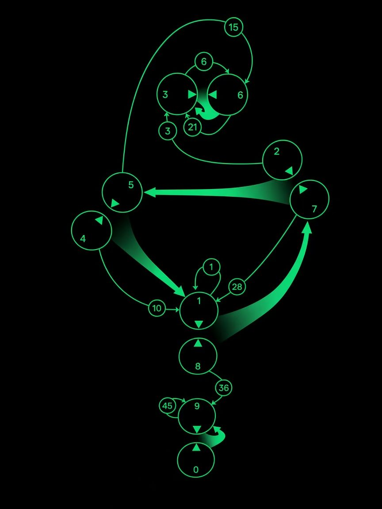

# CCRU Numogram Neural Network & Ritual Music

A unified computational framework built upon the **CCRU Numogram (The Decimal Labyrinth)**, bridging recurrent neural network dynamics, topological graph analysis, and Lemurian ritual microtonal music synthesis.



---

## 1. Codebase Architecture & File Roles

The codebase is organized into three decoupled, complementary modules:

```
┌─────────────────────────────────────────────────────────────┐
│                        numogram.py                          │
│         Core Numogram PyTorch Neural Network Class          │
│   (State recurrence, unrolled BPTT, group diagnostics)      │
└──────────────┬───────────────────────────────┬──────────────┘
               │                               │
               ▼                               ▼
┌───────────────────────────────┐ ┌───────────────────────────┐
│            NNN.py             │ │     numogrammusic.py      │
│  Topology & Graph Analysis    │ │  Ritual Music Synthesis   │
│  - Directed graph conversion  │ │  - 15-tier pitch mapping  │
│  - Pathfinding algorithms     │ │  - Base-n modular tempo   │
│  - Training & BPTT runner     │ │  - Multi-track buzzer audio│
└───────────────────────────────┘ └───────────────────────────┘
```

---

## 2. Core Neural Module: `numogram.py`

[`numogram.py`](numogram.py) is dedicated exclusively to the core [`Numogram`](numogram.py) model and its neural building blocks.

### 2.1 Numogram Neural Topology
The network defines $n$ zones (Zones 0 through 9 for classical $n=10$), each maintaining a hidden state vector $x_i \in \mathbb{R}^d$:
1. **Syzygies (Dual Pairs)**: Complementary pairs $(u, v)$ where $u + v = n - 1$ (e.g. `9::0`, `8::1`, `7::2`, `6::3`, `5::4`). Each pair features mutual linear maps:
   $$x_u \to x_v, \quad x_v \to x_u$$
2. **Currents (Attractor Flows)**: The 5 syzygies project joint activations $[x_u; x_v] \in \mathbb{R}^{2d} \to \mathbb{R}^d$ into gravitational attractors (Tractors $|u - v|$):
   - `(5, 4) -> Zone 1` (Sink)
   - `(8, 1) -> Zone 7` (Surge)
   - `(7, 2) -> Zone 5` (Hold)
   - `(6, 3) -> Zone 3` (Warp attractor)
   - `(9, 0) -> Zone 9` (Plex spiral)
3. **Gates (Triangular Channels)**: 9 canonical triangular number gates ($k \to \frac{k(k+1)}{2} \bmod 9$ in $1..9$) implemented via SwiGLU / MoE-style gating:
   $$A = \sigma(W_A x + b_A), \quad B = W_B x + b_B, \quad M = A \odot B, \quad \text{out} = W_{\text{out}} M + b_{\text{out}}$$
4. **Zone Update Layer**: Synchronously aggregates incoming signals and computes next state:
   $$x_i^{(t+1)} = \text{Linear}([x_i^{(t)}; \text{in\_acc}_i^{(t)}])$$

### 2.2 Analytical Methods
- `compute_spectral_radius(x)`: Computes the Jacobian spectral radius $\rho(J)$ via forward automatic differentiation.
- `print_step_grad_summary()`: Unrolls Backpropagation Through Time (BPTT) and displays per-step gradient Frobenius norms alongside $\rho(J)$.
- `print_group_backward_summary()` & `print_group_forward_summary()`: Partitions the 10 zones into the three canonical tripartite systems (**The Warp**: Zones 3, 6; **The Torque**: Zones 1, 2, 4, 5, 7, 8; **The Plex**: Zones 0, 9) and evaluates average state norm / gradient attenuation across groups.
- High-level delegates: Provides clean instance methods for `to_directed_graph()`, `find_paths()`, `parse_ritual_frequencies()`, and `generate_ritual_audio()`.

---

## 3. Neural & Topological Analysis: `NNN.py`

[`NNN.py`](NNN.py) (**N**umogram **N**eural **N**etwork) handles topological graph transformation, path search, and the execution of training/recurrence benchmarks.

### 3.1 Directed Graph Conversion (`numogram_to_directed_graph`)
Converts the dynamical Numogram topology into a discrete directed graph $\mathcal{G} = (\mathcal{V}, \mathcal{E})$ following three rules:
1. **Currents**: Each syzygy $(u, v) \to \text{tractor}$ adds directed edges $u \to \text{tractor}$ and $v \to \text{tractor}$.
2. **Gates**: Each triangular gate $src \to dst$ adds a directed edge $src \to dst$.
3. **Syzygies**: Each dual pair $(u, v)$ adds bidirectional edges $u \to v$ and $v \to u$.

Supports export as a native adjacency dictionary (`dict[int, list[int]]`) or a NetworkX `DiGraph`.

### 3.2 Path Search Algorithm (`find_paths`)
Finds all directed paths of exact length $n$ between any two zones using depth-first search (DFS):
```python
paths = find_paths(graph, start=2, end=6, n=2)
# Output: [[2, 3, 6], [2, 5, 6]]
```

### 3.3 Running NNN
Run the standalone neural and topological pipeline:
```bash
python NNN.py -n 10
```
This runs a 100-step recurrence trajectory, performs full BPTT gradient tracking, prints the tripartite forward/backward group summaries, and executes sample path searches.

---

## 4. Ritual Frequency & Music Synthesis: `numogrammusic.py`

[`numogrammusic.py`](numogrammusic.py) translates the 45 Lemurian demons from `Pandemonium.json` into multi-track microtonal soundscapes.

### 4.1 15-Level Pitch Scale Mapping
Maps the frequency domain $[33.0\text{ Hz}, 3960.0\text{ Hz}]$ into 15 uniform logarithmic/linear pitch intervals from **Ana-7** (uppermost) down through **Null** to **Cth-7** (lowermost):
- `Ana-1` to `Ana-7`: Ascending, solar/anamorphic treble tier.
- `Null`: Neutral mid-band tier (reserved for the 5 Syzygetic demons).
- `Cth-1` to `Cth-7`: Descending, subterranean/cthonic bass tier.

Within each pitch interval $[a, b]$, a zone node $z \in \{0, \dots, n-1\}$ is mapped to frequency:
$$f(z) = a + (b - a) \times \frac{z}{n}$$

### 4.2 Error Handling & Route Types
- `OccultError`: Raised when attempting to parse unmapped chaotic xenodemon routes marked with `'?'` (`Rt-0:[?]`).
- `SyzygeticError`: Raised when attempting to parse tangential feedback loops marked with `'X'` (`Rt-0:[X]`).

### 4.3 Demon Tempo Algorithm (Base-$n$ Modular Rule)
To avoid artificial periodic lockstep and gaps, each demon's note tempo $T_d$ is calculated from its Net-Span $a::b$ (with $a < b$):
1. In base $n$ ($n=10$): forms the integer $ab = a \times n + b$.
2. Computes the residue modulo $m = n - 1 = 9$ (taking $9$ when the remainder is $0$):
   $$\text{val} = \begin{cases} n - 1 & \text{if } (a \cdot n + b) \bmod (n - 1) = 0 \\ (a \cdot n + b) \bmod (n - 1) & \text{otherwise} \end{cases}$$
3. Sets note duration:
   $$\text{Tempo} = \frac{\text{val}}{n} \quad (\text{seconds})$$

**Mathematical Properties**:
- For $n=10$, this partitions all 45 demons evenly across 9 discrete tempo tiers $\{0.1\text{s}, 0.2\text{s}, \dots, 0.9\text{s}\}$, with **exactly 5 demons per tier**.
- Because $0.1\text{s}$ serves as the common quantum, clicks occur at every $100\text{ms}$ sub-interval, uniformly filling every second with no dead silence.

### 4.4 Audio Synthesis & Timbre
The audio generator synthesizes one looped audio track per demon and merges them into a stereo field:
- **Buzzer Clicks (`timbre="buzzer"`, default)**: Short $30\text{ms}$ electronic piezo pulses ($\sin(2\pi f t) + 0.25\sin(6\pi f t)$ with $2\text{ms}$ anti-pop fades) at the demon's zone frequency, leaving clean transparent silence between clicks.
- **Acoustic Piano (`timbre="piano"`)**: Physical simulation featuring 5-harmonic string resonance and $0.6\text{s}$ decay tails.

### 4.5 Generating Ritual Audio via CLI
Generate merged audio for all non-syzygetic, non-occult demons:
```bash
# Generate 60-second buzzer clicking audio
python numogrammusic.py --audio full_60s.mp3 --duration 60.0

# Generate audio for specific demons
python numogrammusic.py --audio lurgo_duoddod.mp3 --demons "Lurgo,Duoddod" --duration 30.0
```

---

## 5. Summary of Primary Files

| File | Primary Responsibility |
| :--- | :--- |
| [`numogram.py`](numogram.py) | Standalone `Numogram` PyTorch RNN class, SwiGLU gates, BPTT gradient tracker, and group diagnostics. |
| [`NNN.py`](NNN.py) | Graph converter (`numogram_to_directed_graph`), DFS pathfinder (`find_paths`), and network benchmark runner. |
| [`numogrammusic.py`](numogrammusic.py) | Pitch scales, Pandemonium demon parser, base-$n$ modular tempo calculator, and multi-track audio engine. |
| [`Pandemonium.json`](Pandemonium.json) | Complete parsed metadata for all 45 Lemurian demons (Doors, Pitch, Phase-limits, Rituals). |
| [`full_60s.mp3`](full_60s.mp3) | 60-second 36-track merged buzzer click audio generated via the base-$10$ modular tempo algorithm. |
